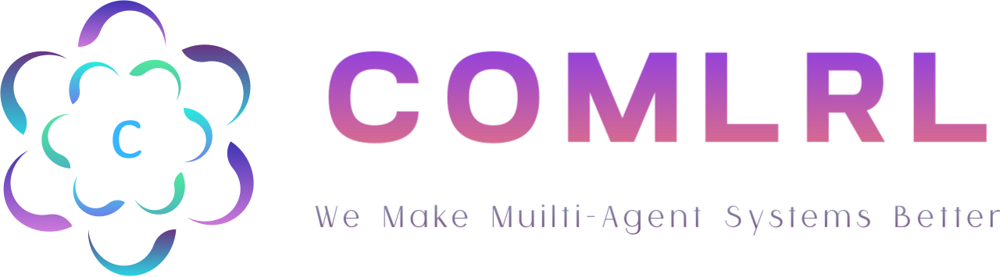
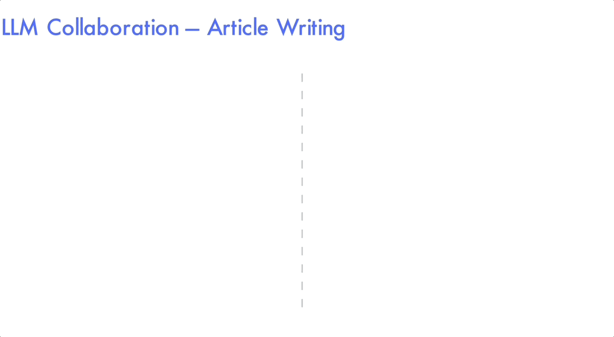
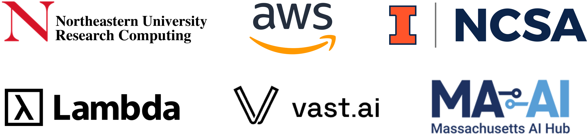

# 

[![OpenMLRL](https://img.shields.io/badge/OpenMLRL-projects-989DD6.svg?logo=)](https://openmlrl.github.io)
[](https://arxiv.org/pdf/2508.04652)
[](https://openmlrl.github.io/CoMLRL/)
[](https://huggingface.co/CoMLRL)

[](https://www.python.org/downloads/release/python-3100/)
[](https://pypi.org/project/comlrl/)
[![Conda version](https://img.shields.io/conda/vn/conda-forge/comlrl.svg?logo=)](https://anaconda.org/conda-forge/comlrl)
[![PyPI downloads](https://img.shields.io/pypi/dm/comlrl.svg?logo=)](https://pypi.org/project/comlrl/)

[](https://github.com/OpenMLRL/CoMLRL/actions/workflows/ci.yml)
[](https://github.com/OpenMLRL/CoMLRL/actions/workflows/tests.yml)
[](https://github.com/OpenMLRL/CoMLRL/actions/workflows/pre-commit.yml)
[](https://github.com/OpenMLRL/CoMLRL/actions/workflows/docs-build.yml)
[](https://github.com/psf/black)
[![license: BSD-3-Clause](https://img.shields.io/badge/license-BSD--3--Clause-orange.svg?logo=)](https://opensource.org/licenses/BSD-3-Clause)

**Co**operative **M**ulti-**L**LM **R**einforcement **L**earning (**CoMLRL**) is an open-source library for training multiple LLMs to collaborate using Multi-Agent Reinforcement Learning (MARL). It provides implementations of various MARL algorithms for LLM collaboration and support for different environments and benchmarks.



## Installation and first run

Install a PyTorch build compatible with your machine, then run an example directly
with Python. No job scheduler or W&B account is required.

```bash
git clone https://github.com/OpenMLRL/CoMLRL.git
cd CoMLRL
pip install -e .
python examples/story-len-ratio.py
```

Memory requirements depend on the model, number of agents, batch size, and response
length. The examples leave W&B logging disabled by default; enable it explicitly
(add `--wandb-project` or `--wandb-entity` to choose where runs are logged):

```bash
python examples/story-len-ratio.py --wandb
```

For use in your own Python programs, CoMLRL is also available via PyPI or conda-forge:

```bash
pip install comlrl
# Or:
conda install -c conda-forge comlrl
```

## Features

- **Cooperative trainers for LLM collaboration:**
  - **_Multi-Agent REINFORCE_:** Critic-free policy gradient methods, including [MAREINFORCE](https://github.com/OpenMLRL/CoMLRL/blob/main/comlrl/trainers/reinforce/mareinforce.py), [MAGRPO](https://github.com/OpenMLRL/CoMLRL/blob/main/comlrl/trainers/reinforce/magrpo.py), [MARLOO](https://github.com/OpenMLRL/CoMLRL/blob/main/comlrl/trainers/reinforce/marloo.py), [MAREMAX](https://github.com/OpenMLRL/CoMLRL/blob/main/comlrl/trainers/reinforce/maremax.py).
    - Aligned individual response joint with `joint_mode='aligned'`.
    - Cartesian-product joint responses with `joint_mode='cross'`.
  - **_Multi-Agent Actor-Critic:_** Actor-Critic methods, including [IAC](https://github.com/OpenMLRL/CoMLRL/blob/main/comlrl/trainers/actor_critic/iac.py) and [MAAC](https://github.com/OpenMLRL/CoMLRL/blob/main/comlrl/trainers/actor_critic/maac.py).
    - Independent actor-critic (separate critic or value-head over LLM backbone).
    - Centralized critic over joint prompts with separate actors.
  - **_Multi-Agent Preference Learning:_** [MADPO](comlrl/trainers/preference/madpo.py), [MARLHF](comlrl/trainers/preference/marlhf.py), and their [iterative variants](comlrl/trainers/preference/iterative.py).
    - Direct joint preference optimization or learned joint rewards followed by RL.
    - Decentralized actors or a centralized actor generating a complete joint response.

- **Environments that simulate real-world tasks for training and evaluating LLM collaboration:**
  - [**_Writing_**](https://github.com/OpenMLRL/LLM_Collab_Writing): Multiple LLM agents collaborate on processing articles.
    - [TLDR](https://huggingface.co/datasets/trl-lib/tldr) - Summarizing Reddit posts.
    - [arXiv](https://arxiv.org/abs/1905.00075) - Expanding abstracts into introductions.
  - [**_Coding_**](https://github.com/OpenMLRL/LLM_Collab_Code_Generation): Generate code solutions for programming problems.
    - [MBPP](https://github.com/google-research/google-research/tree/master/mbpp) - Mostly basic python problems.
    - [HumanEval](https://github.com/openai/human-eval) - Handwritten evaluation problems.
    - [CoopHumanEval](https://huggingface.co/datasets/OpenMLRL/CoopHumanEval) - HumanEval with cooperative nature.
    - [ClassEval](https://conf.researchr.org/details/icse-2024/icse-2024-research-track/219/Evaluating-Large-Language-Models-in-Class-Level-Code-Generation) - Complete class-level code based on attributes and docstrings.
  - [**_Travel_**](https://github.com/OpenMLRL/LLM_Collab_Travel): Collaborative travel planning under user constraints.
    - [TravelPlanner](https://huggingface.co/datasets/osunlp/TravelPlanner) - Planning multi-day trip itineraries.
  - [**_Tool-Use_**](https://github.com/OpenMLRL/LLM_Collab_BFCL-v4): Collaborative function calling with tools using [BFCL v4](https://gorilla.cs.berkeley.edu/leaderboard.html).
    - [Native Parallel](https://huggingface.co/datasets/OpenMLRL/BFCL-V4-Parallel-Native) - Making parallel function calls.

## Usage

Quick start by training two `Qwen-2.5` agents on Reddit prompts with MAGRPO. This toy reward encourages a 3:1 output-length ratio; it does not measure summary quality:

```python
from datasets import load_dataset
from transformers import AutoTokenizer
from comlrl.trainers.reinforce import MAGRPOConfig, MAGRPOTrainer

# Load dataset and tokenizer
tokenizer = AutoTokenizer.from_pretrained("Qwen/Qwen2.5-0.5B")
dataset = load_dataset("trl-lib/tldr", split="train").select(range(128))

# Initialize trainer and start training
trainer = MAGRPOTrainer(
    agent_model="Qwen/Qwen2.5-0.5B",
    num_agents=2,
    tokenizer=tokenizer,
    train_dataset=dataset,
    reward_func=lambda a, b: [
        -abs(len(second) / max(len(first), 1) - 3.0)
        for first, second in zip(a, b)
    ],
    formatters=[lambda example: example["prompt"]] * 2,
    args=MAGRPOConfig(num_turns=1),
)
trainer.train()
```

## Contributing

We thank the gracious help of all contributors:

<p>
<!-- ALL-CONTRIBUTORS-LIST:START - Do not remove or modify this section -->
<table>
  <tr>
    <td align="center"><a href="https://github.com/LovelyBuggies"><br /><sub><b>Shuo Liu</b></sub></a><br /><a href="#ideas" title="Ideas">🤔</a> <a href="https://github.com/OpenMLRL/LLM_Collab_Code_Generation" title="Maintain">🚧</a> <a href="https://github.com/OpenMLRL/CoMLRL/commits?author=LovelyBuggies" title="Code">💻</a> <a href="https://github.com/OpenMLRL/CoMLRL/" title="Docs">📖</a></td>
    <td align="center"><a href="https://github.com/Tenshi0x0"><br /><sub><b>Tianle Chen</b></sub></a><br /><a href="https://github.com/OpenMLRL/LLM_Collab_Code_Completion" title="Maintain">🚧</a> <a href="https://github.com/OpenMLRL/CoMLRL/commits?author=Tenshi0x0" title="Code">💻</a> <a href="https://github.com/OpenMLRL/CoMLRL/issues?q=author%3ATenshi0x0" title="Bug Report">🐛</a></td>
<td align="center"><a href="https://github.com/ryankamiri"><br /><sub><b>Ryan Amiri</b></sub></a><br /><a href="https://github.com/OpenMLRL/LLM_Collab_Software_Engineering" title="Maintain">🚧</a> <a href="https://github.com/OpenMLRL/CoMLRL/commits?author=ryankamiri" title="Code">💻</a> <a href="https://github.com/OpenMLRL/CoMLRL/issues?q=author%3Aryankamiri" title="Bug Report">🐛</a> </td>
    <td align="center"><a href="https://github.com/DannyGetGrammy"><br /><sub><b>Danny Li</b></sub></a><br /><a href="https://github.com/OpenMLRL/CoMLRL/" title="Docs">📖</a> <a href="https://github.com/OpenMLRL/CoMLRL/issues?q=author%3ADannyGetGrammy" title="Bug Report">🐛</a></td>
    <td align="center"><a href="https://github.com/zedyelllion"><br /><sub><b>Zeyu Liang</b></sub></a><br /> <a href="https://github.com/OpenMLRL/CoMLRL/" title="Docs"></a> <a href="https://github.com/OpenMLRL/CoMLRL/" title="Docs">📖</a> <a href="https://github.com/OpenMLRL/CoMLRL/issues?q=author%3Azedyelllion" title="Bug Report">🐛</a></td>
 </tr>
</table>
<!-- ALL-CONTRIBUTORS-LIST:END -->
<sub>🤔: Foundational Ideas; 🚧: Maintenance; 💻: Code; 📖: Documentation; 🐛: Bug Report.</sub></p>

For new contributors, please see [contributing guidelines](./CONTRIBUTING.md) on setting up a dev environment.

## Sponsorship

CoMLRL was developed using substantial computational resources. Its growth has been made possible by the generous support of the following organizations and institutions.

<p></p>

We welcome computational sponsorship to support the continued development of CoMLRL. If you are interested in supporting this project, please contact us.
<a href="mailto:liu.shuo2@northeastern.edu"></a>

## Citation

Please cite the following papers if you find this library useful in your research:

```bibtex
@inproceedings{liu2026llm,
  title={LLM Collaboration with Multi-Agent Reinforcement Learning},
  author={Liu, Shuo and Liang, Zeyu and Lyu, Xueguang and Amato, Christopher},
  booktitle={Proceedings of the AAAI Conference on Artificial Intelligence},
  volume={40},
  number={38},
  pages={32150--32158},
  year={2026}
}

@inproceedings{liu2026learning,
  title   = {Learning Decentralized LLM Collaboration with Multi-Agent Actor Critic},
  author  = {Liu, Shuo and Chen, Tianle and Amiri, Ryan and Amato, Christopher},
  booktitle={Proceedings of the International Conference on Machine Learning.},
  year    = {2026}
}

@article{liu2026improving,
  title={Improving LLM Collaboration via Multi-Agent Preference Learning},
  author={Liu, Shuo and Li, Xinzichen and Chen, Tianle and Amato, Christopher},
  journal={arXiv preprint arXiv:2609.32827},
  year={2026}
}
```
